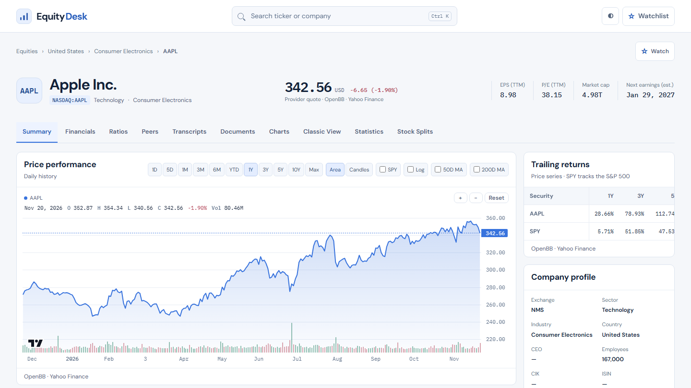

# Equity Desk

A local stock research dashboard built on [OpenBB](https://github.com/OpenBB-finance/OpenBB) data providers. Look up a company by ticker or name to see its quote, financial statements, ratios, valuation history, peers, price chart, dividends and splits in one place. It runs on your own computer, and the default feeds need no API keys.

**New here? Follow the step-by-step guide to install it and get live data: https://yestertommorrow-a11y.github.io/Equity_Desk/**



## Features

- **Summary:** quote and key figures (EPS and P/E on a trailing basis, market cap, next earnings date), an interactive price chart, trailing returns against SPY, financial highlights, capital structure, growth rates, company profile, similar companies and news.
- **Price chart:** area or candlestick chart from [TradingView Lightweight Charts](https://github.com/tradingview/lightweight-charts), with volume, 50- and 200-day moving averages, a log scale, an indexed comparison with SPY, and zoom. If the chart library can't be loaded or built, a simpler built-in chart is drawn instead.
- **Financials:** income statement, balance sheet and cash flow, as annual, quarterly or trailing 12 months (TTM). Includes unit, per-share and year-over-year views, and CSV export.
- **Ratios:** profitability, liquidity, credit (including quick ratio and Debt/EBITDA) and valuation, plus a **valuation history** that applies each period's closing price to that period's figures.
- **Peers:** a side-by-side comparison with up to 10 companies in the same industry and region. You can add, remove and sort companies, and median values are shown.
- **Statistics, Charts, Classic View:** valuation, yields, trends, ownership and analyst estimates, plus a compact one-page historical overview.
- **Transcripts, Documents, Stock Splits:** earnings dates, links to filings, and a split timeline.
- A watchlist, light and dark themes, a <kbd>Ctrl</kbd>+<kbd>K</kbd> search shortcut, and a layout that works on a phone. The watchlist and theme are saved in your browser.

## Quick start

You need **Python 3.12** and an internet connection.

```powershell
git clone https://github.com/yestertommorrow-a11y/Equity_Desk.git
cd Equity_Desk
py -3.12 -m venv .venv
.\.venv\Scripts\python.exe -m pip install -r requirements.txt
```

**Windows:** double-click **`Start Equity Desk.cmd`**. It opens http://127.0.0.1:8766 in your browser. Leave its window open while you use the dashboard, and close it to stop the server.

**macOS / Linux:**

```bash
python3.12 -m venv .venv
.venv/bin/python -m pip install -r requirements.txt
.venv/bin/python server.py --port 8766 --open
```

`server.py` options:

| Option | Default | Description |
| --- | --- | --- |
| `--port` | `8765` | Port to serve on. The Windows launcher uses 8766. |
| `--open` | off | Open the dashboard in your browser. If the port is already serving Equity Desk, it opens that instead. |

Visit `/api/health` to see which OpenBB provider extensions the running Python can load.

## Data sources

Each section shows which provider its data came from. The provider depends on the listing:

| Listing | Providers |
| --- | --- |
| US stocks and ETFs | Yahoo Finance, SEC EDGAR (preferred for statements and filings), Nasdaq, Cboe |
| Canadian listings (for example `RY.TO`, `TSX:SHOP`) | Yahoo Finance, TMX |
| Other exchanges (for example `7203.T`, `0700.HK`, `VOD.L`) | Yahoo Finance |

If one provider fails, the next one configured for that section is tried. Exchange-prefixed tickers such as `NASDAQ:AAPL` also work. Indices, currencies, futures and crypto pairs (`^GSPC`, `EURUSD=X`) aren't supported; use an ETF that tracks them instead, such as SPY for the S&P 500.

## How the numbers are handled

- **Missing data stays blank.** Gaps aren't filled with zero or estimated, and when a provider fails, the affected section says so.
- **Currencies:** statements keep their reporting currency. Ratios that would mix the quote currency with a different (or unknown) reporting currency are left blank.
- **Stock splits:** per-share figures and share counts are restated to the current share basis using the split history. Each period's share count is checked to see whether the provider has already restated it. Periods that can't be checked are left as reported and flagged.
- **TTM:** built from four consecutive reported quarters in the same currency, and shown only when they're available.
- **Yahoo Finance limits:** at most five annual or quarterly statements.
- **Dates:** earnings dates are compared with the current date in New York, because they are US exchange dates.
- **Prices can be delayed.** Check each section's dates, currency and source before relying on a figure.

## Security

The server only listens on `127.0.0.1`. It rejects requests with an unexpected `Host` header (protection against DNS rebinding), serves only a fixed list of files, and only allows read-only `GET` requests. It doesn't place trades or store credentials.

## Project structure

```
server.py               Local HTTP server and JSON API
backend/openbb_data.py  Provider routing, caching, split restatement, peers
public/                 Front end (index.html, app.js, detail.js, style.css)
public/vendor/          TradingView Lightweight Charts 5.2.1 (Apache-2.0)
tests/                  Synthetic-data checks for the backend and calculations
docs/                   GitHub Pages setup guide and screenshot
Start Equity Desk.cmd   Windows launcher
```

## Tests

The tests use synthetic data, so they don't need network access:

```bash
python tests/fuzz_backend.py .
node tests/fuzz_detail.mjs public/detail.js
node tests/fuzz_valuation.mjs public/detail.js
node tests/fuzz_detail2.mjs public/detail.js     # prints computed values for manual review
```

`tests/mock_fetch.js` can be injected into the running page to load a synthetic company, `MOCK`, whose results are known in advance.

## Disclaimer

Equity Desk is for research and education. It is not investment advice. Data comes from third-party providers and may be delayed, incomplete or wrong. Check it against original filings before making decisions.

## License

Equity Desk is released under the [MIT License](LICENSE). The bundled TradingView Lightweight Charts library keeps its own Apache 2.0 license (see `public/vendor/lightweight-charts-LICENSE.txt`).
